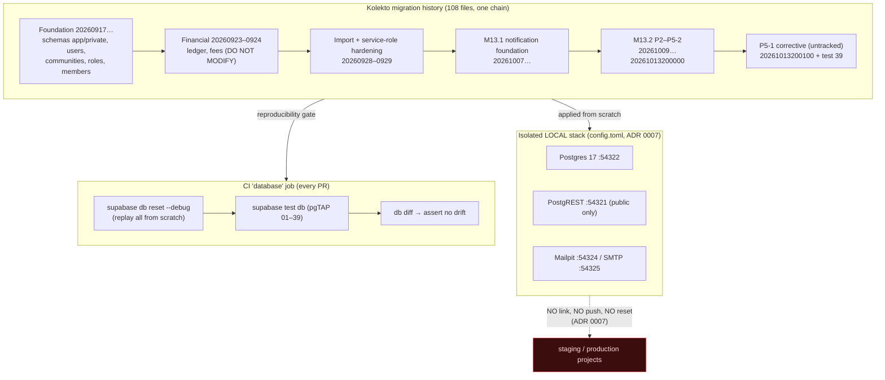

# M13.2 — Migration Impact Inventory

> Read-only audit of the Kolekto migration history, produced 2026-10-13 on branch
> `m13.2-p5-2-rate-limits`. No schema, data, or migration file was changed to produce
> this document. It records what the migrations **actually** create (verified against the
> SQL, not filenames or comments), which objects M13.2 depends on, and what a fresh local
> database must contain.

## 1. Scope and method

- Migration directory: `supabase/migrations/` — **108 files**, `20260917120000` … `20261013200100`.
- pgTAP suites: `supabase/tests/` — **39 files** (`01` … `39`).
- Verification: SQL inspected directly (`create table/function/policy/trigger/index/type`),
  cross-checked against pgTAP fixtures and the P5-2 implementation record.
- **The last migration (`20261013200100`) and test (`39`) are untracked and preserved** —
  they are the retry-then-sent corrective change and its regression test.

## 2. Migration history at a glance

The chain is one continuous Kolekto history. M13.2 is **not** a separable database — its
notification tables reference `auth.users`, `public.users`, `public.communities`, and the
`app` helper-function schema established far earlier in the chain (proven by every
notification pgTAP fixture, e.g. test `39` seeds `auth.users` → `public.users` →
`public.communities` → `notification_events` → `notification_deliveries`).

| Block | Timestamp range | Domain | Required for fresh DB | M13.2-specific |
|---|---|---|---|---|
| Foundation | `20260917120000`–`121100` | extensions, schemas (`app`/`private`), enums, users, communities, roles/officers, members, invites, collections, obligations, audit_log, base RLS + grants | Yes | No |
| Migration/import framework | `20260918130000`–`140200` | migration schema, provenance/idempotency, legacy links, bootstrap, app write functions/grants | Yes | No |
| Collections & members | `20260919120000`–`20260922110000` | collection/obligation functions, member identity & groups, invitation profiles, audience, types, covers, check-ins, references, contributor identification | Yes | No |
| Financial | `20260923100000`–`20260924170000` | fee mode/schedules, **ledger**, financial idempotency, chart of accounts, balance views, event processing, execute hardening | Yes | No |
| Import hardening | `20260928100000`–`20260929100300` | citext email comparisons, service-role privilege lockdown, importer role & grants, truncate/immutability guards | Yes | No |
| Auth/workspace | `20260930100000`–`20260930120000` | reserved slugs, onboarding state, personal workspace | Yes | No |
| **Notifications (M13.1/M13.2)** | `20261007100000`–`20261013200100` | see §3 | Yes | **Yes** |

> The financial, import-hardening, service-role, and RLS/grant migrations are **out of
> scope for modification** (global + project safety rules) but **in scope as dependencies**:
> notification RLS and grants reuse the same `app`/`private`/service-role boundary.

## 3. Notification subsystem (M13.1 + M13.2) — detail

| Migration | Phase | Objects created / replaced (verified) | Kind |
|---|---|---|---|
| `20261007100000_notification_foundation` | M13.1 | types `notification_channel`, `notification_delivery_status`; tables `notification_events`, `notification_deliveries`, `notification_preferences`; event-immutability trigger; RLS policies (own-inbox / officer / own-prefs); `app.mark_notification_read`, `app.mark_all_notifications_read`, `app.enqueue_notification_on_audit` + audit trigger | Additive |
| `20261007110000_notification_foundation_fixes` | M13.1 | foundation corrections | Corrective |
| `20261009100000_notification_delivery_status_values` | P? | delivery-status value set | Additive |
| `20261009100100_notification_delivery_access` | P2 | `notification_deliveries_dedupe_key_key` unique index; `app.mask_email_address`; `app.list_email_delivery_log` (privacy-scoped log) | Additive |
| `20261009100200_notification_event_payload_guard` | P3 | `app.sanitize_notification_event_payload` + trigger | Additive |
| `20261009100300_notification_payload_nested_keys` | P3 | `app.strip_banned_payload_keys`, `app.payload_has_banned_key`, re-defined sanitizer | Corrective |
| `20261009110000_notification_trigger_and_suppression` | P3 | table `notification_suppression_log` (+ deny-client RLS, append-only triggers); `app.notification_suppression_state`, `app.begin_notification_suppression`; re-defined enqueue | Additive |
| `20261009120000_notification_suppression_lapse` | P3 | re-defined `notification_suppression_state` + `enqueue_notification_on_audit`; `app.release_held_notifications`, `app.discard_held_notifications` | Corrective |
| `20261012100000_notification_recipient_eligibility` | P4 | `app.email_address_usable`, `app.evaluate_email_eligibility` | Additive |
| `20261013100000_notification_send_claims` | P5-1 | claim/lease indexes; `app.claim_notification_delivery`, `app.claim_next_notification_delivery`, `app.resolve_notification_claim`, `app.recover_expired_notification_lease` | Additive |
| `20261013200000_notification_rate_limits` | P5-2 | table `notification_send_attempts` (deny-client RLS, append-only triggers, 3 window indexes); `app.notification_send_limits`, `app.reserve_email_attempt`, `app.purge_stale_send_attempts` | Additive |
| `20261013200100_fix_resolve_claim_stale_error_fields` **(untracked)** | P5-1 corrective | re-defines `app.resolve_notification_claim` to null `error_code`/`error_message` on the `sent` outcome | Corrective |

**Objects touched across multiple timestamps** (schema drift risk if reordered):
`app.enqueue_notification_on_audit` (3×: foundation → suppression → lapse),
`app.notification_suppression_state` (2×), `app.sanitize_notification_event_payload` (2×),
`app.resolve_notification_claim` (2×: P5-1 → corrective). All use `create or replace`; the
**timestamp ordering is load-bearing** — the corrective must apply after its base.

### Confirmed P5-2 limits (`app.notification_send_limits`, line 148)

`select 3, 24, 100, 1, 1000, 1, 500, 3` →

| Limit | Value |
|---|---|
| L1 per address / rolling window | **3** / **24 h** |
| L2 per community / rolling window | **100** / **1 h** |
| L3 platform-wide / rolling window | **1,000** / **1 h** |
| Backlog cap per community | **500** |
| Max attempts per delivery | **3** |

These match the approved P5-2 figures exactly. The ledger (`notification_send_attempts`) is
append-only, no client role has access, and `app.purge_stale_send_attempts` deletes rows
older than 48 h (risk U7: short-lived PII surface).

## 4. Impact matrix (key objects)

| Database object | Defining migration | Callers | Tests | Security boundary | Rebuild req. | Action |
|---|---|---|---|---|---|---|
| `notification_events` / `_deliveries` / `_preferences` | `20261007100000` | worker, web inbox, audit trigger | 31, 32 | RLS: own-inbox / officer / own-prefs | Required | None (verify present) |
| `app.enqueue_notification_on_audit` + audit trigger | 1007→1009×2 | audit-log writes | 34, 35 | security definer, `search_path=''` | Required | Keep ordering |
| `notification_suppression_log` + release/discard | `20261009110000`/`120000` | operator/worker | 34, 35 | deny-client RLS, append-only | Required | Do **not** auto-release |
| `app.evaluate_email_eligibility` | `20261012100000` | worker | 36 | security definer | Required | None |
| claim/lease fns | `20261013100000` | worker | 37 | operator/worker only | Required | None |
| `notification_send_attempts` + reserve/limits/purge | `20261013200000` | worker | 38 | deny-client RLS, append-only | Required | None |
| `app.resolve_notification_claim` (sent clears errors) | `20261013200100` **(untracked)** | worker | **39** | operator/worker only | Required | **Preserve; needs commit** |

No stale references, duplicate implementations, or missing objects were found in the
migration chain itself. The only object defined outside the committed history is the
corrective `resolve_notification_claim`, which exists only as the untracked file.

## 5. Dependency & environment diagram

## 6. Reproducibility finding

The migration chain is **already proven reproducible from scratch on every pull request**:
the CI `database` job runs `supabase db reset --debug` (replay all 108), then
`supabase test db` (pgTAP 01–39), then `supabase db diff` asserting zero drift across
`public,app,private`. This is the strongest possible evidence that **Option 1 (fresh local
from existing history)** is correct and that no baseline fabrication or history deletion is
needed. See the Clean Local Database Plan for the decision.

> Local validation of this claim was **not executed in this session** — Docker Desktop is
> not running, so the local stack is down. CI evidence is historical, not re-run here.
