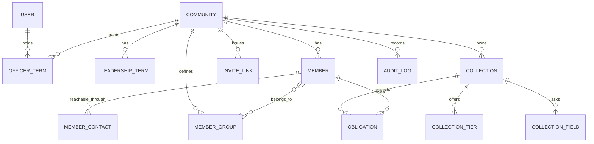
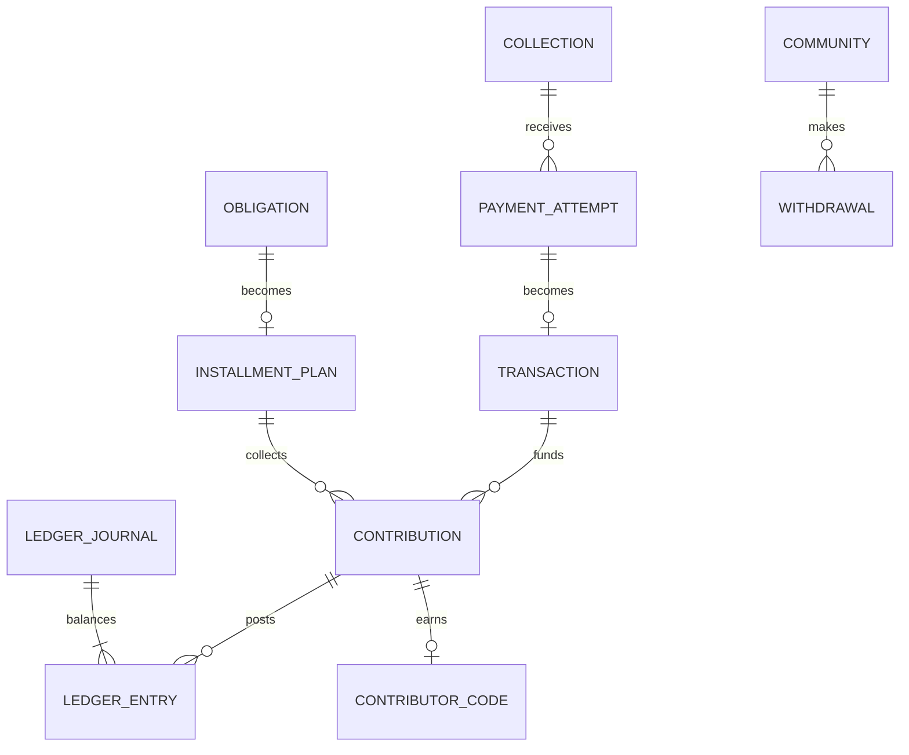

# Target schema

The whole domain model, including the parts not yet built. Built tables link to
the migration that creates them; deferred tables name the decision gating them.

## What exists now

| Table | Migration | Purpose |
|---|---|---|
| `users` | `…120200_users` | A login. Never owns a financial object. No `role` column. |
| `communities` | `…120300_communities` | The root aggregate. |
| `community_slug_history` | `…120300_communities` | COM-04: old links keep resolving. |
| `community_labels` | `…120300_communities` | COM-05: "Member" reads as "Unit" for an estate. |
| `permissions`, `role_permissions` | `…120400_roles_and_officers` | PRD 2.2 as data. |
| `leadership_terms`, `officer_terms` | `…120400_roles_and_officers` | Time-bounded authority. |
| `members`, `member_attribute_definitions`, `member_groups`, `member_group_memberships`, `member_contacts` | `…120500_members` | The roll. |
| `invite_links`, `officer_invitations` | `…120600_invites` | Hashed tokens (SEC-20b). |
| `collections`, `collection_tiers`, `collection_fields`, `collection_code_settings` | `…120700_collections` | The core object; tiers as rows (ADR 0010). |
| `obligations` | `…120800_obligations` | Who is expected to pay what. |
| `audit_logs` | `…120900_audit_log` | Append-only (DAT-02). |

## What is designed and not built

Each of these is blocked on a decision, not on engineering time. Building
against a guess is worse than waiting, because a half-built ledger gets trusted.
See [ADR 0006](adr/0006-ledger-deferred.md).

| Table | Gated on | Shape |
|---|---|---|
| `paystack_events` | DEC-02 | Raw event stored **before** acknowledgement, unique on event key. NFR-11: zero lost events. The previous system had no such table, so a failed event past Paystack's retries was simply gone. |
| `payment_attempts` | DEC-01, DEC-02 | The amount lock (COL-10). Carries `tier_id` as a **non-null FK** for tiered collections — an amount is never used to infer what was bought (ADR 0010). |
| `transactions` | DEC-02 | A mirror of Paystack. Amounts never change; refunds and reversals are separate records. |
| `contributions` | DEC-01, DEC-02 | Money applied to a collection. Unique on `(payment_reference, line_index)` — the partial unique index that worked in the old system and should be carried across. |
| `installment_plans` | DEC-23 | The unfinished-plan rule is stored **on the plan at creation** (INS-20), so a later change to the collection cannot alter a contributor's terms. |
| `contributor_codes` | — (needs contributions) | Unique per collection, never reused, voided on refund (CODE-04, CODE-07). |
| `ledger_accounts`, `ledger_journals`, `ledger_entries` | DEC-01, DEC-03 | Append-only double entry. The twelve-account chart in PRD 9.7 assumes the balance model; the subaccount fallback needs fewer. |
| `balance_releases` | DEC-01, DEC-25 | The T+1 job's output, at 00:05 WAT. DEC-25 decides calendar days versus Paystack business days. |
| `holds` | DEC-06 | Dispute and risk holds, with a reason officers can read (TRU-05). |
| `withdrawal_accounts`, `withdrawals`, `withdrawal_allocations` | DEC-01, DEC-06, DEC-07 | Idempotent on the Kolekto reference (WDR-05) — the old system used synthetic `MAN_*` placeholders because payouts were manual. |
| `refunds`, `disputes` | DEC-08, DEC-09 | No Refund API integration exists today at all, which is why overpayments have no remedy. |
| `notifications` | DEC-17 | One service, provider adapters, fallback chain, per-community metering (NOT-14). |
| `verification_records` | DEC-04, DEC-05 | Stores the provider's reference and result, not raw ID data, unless DEC-04 requires otherwise. |
| `handovers`, `handover_changes`, `recovery_requests` | — | Phase 4. No external decision blocks these; they need officer terms, which exist. |
| `staff_users` | — | ADR 0009. A separate realm with mandatory MFA. |
| `fee_schedules` | DEC-11 | Versioned. Every money row stores the version it used (PRC-09). |

## Invariants the database enforces

Not the application. These are in migrations and asserted by `supabase/tests`.

| # | Invariant | Where |
|---|---|---|
| 1 | Money is `bigint` kobo | `app.kobo` domain; `03_money_invariants.sql` |
| 2 | RLS enabled **and forced** on every table in `public` | `01_rls_coverage.sql` |
| 3 | `anon` holds nothing; `authenticated` holds SELECT on an allowlist | `02_grant_matrix.sql` |
| 4 | No SECURITY DEFINER view anywhere | `01_rls_coverage.sql` |
| 5 | No SECURITY DEFINER function executable by `PUBLIC` | `02_grant_matrix.sql` |
| 6 | An obligation cannot be marked paid by hand | `app.block_manual_paid_status`; `05_guards.sql` |
| 7 | Nothing with financial history is deletable | three delete guards; `05_guards.sql` |
| 8 | Two tiers cannot share a name in one collection | `collection_tiers_unique_name`; `05_guards.sql` |
| 9 | A community always keeps one active owner | `app.assert_community_has_owner`; `05_guards.sql` |
| 10 | Tenancy cannot be crossed | `app.assert_obligation_tenancy`, `app.assert_tier_is_consistent`; `05_guards.sql` |
| 11 | One officer role per person per community | `officer_terms_one_active_role_per_person` |
| 12 | One obligation per member per collection per cycle | `obligations_unique_member_cycle` |
| 13 | A member identifier is unique within its community | `members_community_identifier_key` |
| 14 | Audit rows cannot be updated or deleted | trigger + revoked privileges |

**Still to add when the money tables arrive:** a deferred constraint trigger
asserting every ledger journal balances; append-only enforcement on
`ledger_entries` and `paystack_events`; unique `(payment_reference, line_index)`
on contributions; unique idempotency key per journal; and extending the
collection and member delete guards to check contributions, ledger entries and
withdrawals. `05_guards.sql` gains a test for each.

## Naming conventions

- Money columns end in `_kobo` and are `bigint`. The invariant gate greps for this.
- Timestamps are `timestamptz`, stored UTC, displayed WAT (FIN-10).
- Tokens are stored as `*_token_hash` (sha-256 hex) with a `*_token_prefix` for lookup.
- State columns are Postgres enums, never `varchar`.
- Foreign keys to financial rows are `ON DELETE RESTRICT`. `CASCADE` appears only where deleting the parent genuinely means the child is meaningless.
